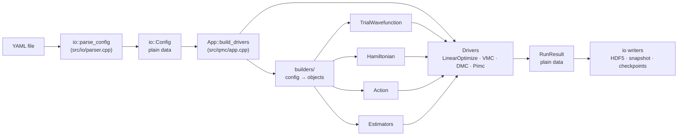

<!--
SPDX-FileCopyrightText: 2026 The Alea Authors

SPDX-License-Identifier: GPL-3.0-or-later
-->

# Architecture

This page explains how the source is organized and how a run flows through it.
Read it before changing code. The physics behind each method is in
[Concepts](concepts.md); what each estimator measures is in
[Estimators](estimators.md).

## Layers



Three rules hold the layers apart:

1. **Only `src/io/` touches files.** Drivers return a `RunResult` (pure data) and
   `main.cpp` hands it to `io::write_run_result`. Checkpoints go through callbacks
   that `App` installs. This keeps the physics testable without a filesystem.
2. **Only `src/builders/` reads the config.** Physics classes receive constructor
   arguments, never an `io::Config`. A new YAML option is parsed in `io/`,
   translated in `builders/`, and arrives in physics code as a typed value.
3. **Refuse rather than approximate.** Unsupported combinations (an unknown term,
   a moiré potential incommensurate with the cell, a Padé Jastrow in a periodic
   cell without an Ewald term) throw at build time with a message that says what to do. A silently
   different model would look like a converged result.

## Source map

| Directory | Responsibility | Key types |
|---|---|---|
| `src/io/` | YAML parsing, logging, results and checkpoint files | `Config` and the `*Spec` structs (`parser.h`), `Logger`, `write_run_result`, `write_config_snapshot`, `read_walkers`/`write_walkers`, `read_paths`/`write_paths` |
| `src/builders/` | Translate specs into objects; one file per family | `build_component(spec, ctx)` overloads, `build_ewald`, `build_action`, `build_exchange_classes`, `build_estimator(spec, ctx)` overloads and `build_estimators` |
| `src/qmc/` | Ground-state drivers and stage orchestration | `App`, `Driver`, `VMC`, `DMC` with `PopulationControl` and `ForwardWalking`, `LinearOptimize` with `CostFunction` and `LinearMethod`, `RunResult` |
| `src/pimc/` | Path-integral driver | `Pimc`, `PathSet`, `Action` and its `ActionComponent`s (`PrimitiveKineticAction`, `PrimitivePotentialAction`, `PairProductAction`, `FixedNodeRestriction`), `Move` (`BisectionMove`, `CentroidMove`, `SingleSliceMove`, `PermutationMove`, `JointPermutationMove`, `WormMove`) |
| `src/wavefunction/` | Trial-wavefunction factors | `TrialWavefunction`, `WavefunctionComponent`, `PadeJastrow`, `RadialPairJastrow` (`DrummondJastrow`, `ZeroEnergyJastrow`), `KSpaceJastrow`, `NosanowJastrow`, `MoireJastrow`, `SlaterDeterminant`, `BackflowSlaterDeterminant`, `BackflowPairingDeterminant`, `ComplexBackflowSlaterDeterminant` (all on `BackflowTransformation` and `BackflowFunction`), `ComplexSlaterDeterminant`, `PairingDeterminant`, `CenterOfMassMomentum`, orbital sets |
| `src/hamiltonian/` | Kinetic energy and potentials | `Hamiltonian`, `HamiltonianComponent`, `Kinetic`, `CoulombTerm`, `KeldyshTerm`, `ScreenedCoulombTerm`, `InversePowerTerm`, `EwaldTerm`, `HarmonicTrap`, `MoireTerm` |
| `src/estimators/` | Optional observables | `Estimator`, `PairCorrelation`, `Density`, `CollectiveDensity`, `StructureFactor`, `ElectronHoleProximity`, `BraggOrder`, `BondOrder`, `DensityMatrix`, `MomentumDistribution`; block statistics `BlockMoments` and `EstimatorReblocking` |
| `src/population/` | Configurations and geometry | `SimulationCell`, `ParticleGroup`, `ParticleBatch`, `WalkerSet`, `ConfigurationBatch`, `Walker`, `WalkerEnsemble`, `BatchedDistanceTable` |
| `src/numerics/` | Shared mathematics | Random numbers (`XoshiroRandom`, `Random`, `stream_seed`), block statistics and reblocking (`statistics.h`), Ewald and long-range breakup, radial tables, special functions, quadrature |

## What happens in a run

`main.cpp` is short and worth reading in full. In order:

1. **Parse.** `io::parse_config_file` turns the YAML into an `io::Config`. A seed
   of 0 is replaced by a random one here, so every later stage and the snapshot
   see the same value.
2. **Create the output directories**: `results/<name>/<timestamp>/`, and
   `checkpoints/<name>/<timestamp>/` if any stage saves walkers or paths.
3. **Build** (`App::build_drivers`):
   1. the particle groups from `system.particles`;
   2. the `SimulationCell` (open or periodic), checked against the rest of the
      config;
   3. the `Hamiltonian`, before the wavefunction, because the Jastrow cusps are
      read from its potentials;
   4. the `TrialWavefunction`, one component per `wavefunction:` item;
   5. per stage, a `WalkerEnsemble` (its starting configurations), the stage's
      estimators and its driver. A PIMC stage also gets its own `Action`.
      Optimizers come first, then the VMC, DMC and PIMC stages in document
      order.
4. **Run** each driver in turn. Before driver *i* runs, `carry_over_walkers`
   seeds its ensemble with driver *i−1*'s final configurations, unless the stage
   has an explicit `walkers_in` or `paths_in`. VMC and DMC hand on their
   walkers. The optimizer and PIMC hand on nothing, so the next stage keeps its
   own start. A PIMC stage that receives walkers starts each replica as a ring
   collapsed onto one of them. After a driver runs, `main` prints `summary()`
   and writes `run_result()` to `<i>_<method>.h5`.
5. **Snapshot.** `write_config_snapshot` rewrites the input with the resolved
   seed and the final wavefunction parameters, without the optimizer stages.

All stages share **one** `TrialWavefunction` and **one** `Hamiltonian` (held by
`DriverPack`). That is how an optimizer's result reaches the stages that follow
it.

## Shared building blocks

### Composites and cloning

The trial wavefunction, the Hamiltonian and the PIMC action are composites, and
each driver holds a list of estimators:

```
TrialWavefunction ── vector<unique_ptr<WavefunctionComponent>>
  ln ψ = Σ_c ln ψ_c,  ∇ ln ψ = Σ_c ∇ ln ψ_c, ...
Hamiltonian ── vector<unique_ptr<HamiltonianComponent>>
  E_L = Σ_c (the kinetic term reads ψ; potentials read positions only)
Action ── vector<unique_ptr<ActionComponent>>
  S = Σ_c S_c,  ΔS of a move = Σ_c ΔS_c
```

Every component, and every estimator, implements `clone()` (a deep copy), so
each thread owns independent copies and no locks are needed.

The wavefunction and the action meet in the fixed-node restriction: a nodal
factor exposes its determinant blocks (`WavefunctionComponent::nodal_blocks()`,
real `SlaterDeterminant` only), and `build_action` copies their orbital sets
into a `FixedNodeRestriction`. PIMC and DMC of one input therefore use the same
nodal surface. A backflow determinant exposes none (its nodes are not
those of plain orbitals), so PIMC refuses it.

**Interfaces to read:** `src/qmc/driver.h`,
`src/wavefunction/wavefunction_component.h`,
`src/hamiltonian/hamiltonian_component.h`, `src/pimc/action_component.h`,
`src/pimc/move.h`, `src/estimators/estimator.h`.

### `ParticleBatch`: one potential code for walkers and paths

`ParticleBatch` holds *nw* configurations with their distance tables, which is
everything a potential $V(R)$ or a structural estimator needs. Two classes
derive from it:

- `WalkerSet`: one configuration per walker (VMC, DMC, optimizer), plus
  $\ln\psi$, its derivatives, local energies and weights;
- `PathSet`: one configuration per imaginary-time slice (PIMC).

So `HamiltonianComponent::evaluate_potential` and `Estimator::accumulate`
serve every driver: a new potential or estimator works in PIMC as soon as it
works in VMC, unless its builder refuses the sampler.

### Data layout

Arrays are **structure-of-arrays with the walker (or slice) index fastest**:

```
positions, gradients, laplacians   [p * dim * nw + d * nw + w]
distance table                     [i * np * nw + j * nw + w]
PIMC path                          [p * dim * M  + d * M  + k]
```

The innermost loop of every kernel runs over walkers or slices. That loop is
contiguous in memory, has no data-dependent branches, and is vectorized by the
compiler (`-fopenmp-simd`, `-fno-math-errno`). Declarations state their layout
in a comment, e.g. `// [np * dim * nw]`. Scratch buffers are sized before the
hot loops (`prepare`, `resize_caches`), so nothing allocates inside a sweep or
a move.

## Drivers

Every method implements `Driver` (`run`, `summary`, `run_result`,
`final_configurations`). They share the building blocks above and differ in
what they sample and how a configuration changes:

| Driver | Configurations | How they change | Parallel unit | Per thread |
|---|---|---|---|---|
| `VMC` | walkers, one `WalkerSet` per thread | single-particle Metropolis or Langevin moves | the walkers, split over threads | clones of ψ, H and the estimators; its own RNG |
| `DMC` | one global population (`WalkerSet`) | drift–diffusion moves, reweighting, branching | contiguous walker ranges ("crowds") | shared ψ and H: crowds touch disjoint ranges of the component caches |
| `LinearOptimize` | the walkers of an internal `VMC` run, stored as frames | parameter updates between samples | as VMC while sampling, then the frames | clones of ψ, H, the RNG and the `CostFunction` |
| `Pimc` | one `PathSet` per replica | moves of beads, paths and permutations | the replicas, spread over threads | its own `PathSet`, `Action` clone, moves, estimators and RNG |

### VMC and DMC moves: ratio, then accept

VMC and DMC move one particle at a time. For particle *p* each component:

1. `ratio_batch(batch, p)` computes $\ln\vert\psi_c(R')/\psi_c(R)\vert$, plus the
   new gradient and Laplacian, for every walker at once, and keeps them as
   *pending*;
2. `apply_move_batch(batch, p, accept_mask)` commits the pending values for
   accepted walkers and discards them for the others.

`evaluate_batch` recomputes everything from scratch; it is used at start-up and
after branching or carry-over.

A sweep moves every particle of a block of walkers before moving to the next
block (`src/qmc/sweep_blocking.h`). The block size comes from the committed
state per walker (`walker_state_bytes()` of ψ and of the `WalkerSet`), so a
large determinant's inverse matrices stay in cache across the sweep. The
sweep's random numbers are drawn first, in a fixed order per particle (the
Gaussian displacements, then one acceptance uniform per walker, used or not).
Each walker reads its own entries, so the result does not depend on the block
size.

Estimators that take ratios of ψ at virtual configurations (`density_matrix`)
use the same two steps with nothing accepted, or `shifted_pair_ratios_batch`
for two particles moved together. The driver gives such an estimator its own
copy of ψ (`bind_wavefunction`), so the sampling caches are never touched.

### DMC population

DMC advances the whole population with one shared ψ and H: each crowd sweeps
its own walker range. After each step, the branching and `PopulationControl`
(trial energy, reference energy, branch weight) run serially; the large gathers
that move walker state (determinant matrices, distance tables) use the worker
team. The per-walker caches of every component (`log_psi_c_`, `grad_c_`,
`lap_c_`, `value_c_`) follow their walkers through `permute_caches`. The node
gate in `dmc.h` rejects moves that cross a node of a real trial.

Pure estimators (`ForwardWalking`, `src/qmc/forward_walking.h`) hook into the
same serial section: before branching they store a snapshot of the positions
when one is due and measure the snapshots whose lag has come, through a
`ConfigurationBatch` (positions and distance tables, no ψ) and the ordinary
`Estimator::accumulate`; after branching they carry each snapshot's ancestor
indices through the same source map as `permute_caches`.

### Linear optimizer

Each iteration runs a `VMC` driver whose measurement hook keeps the
configurations as frames.
`CostFunction` accumulates the energy and the parameter-derivative matrices,
reduced across threads, and `LinearMethod` solves the generalized eigenproblem
for each candidate shift. A complex trial supplies both parts of the
log-derivatives (`compute_complex_parameter_derivatives`, and the complex
curvature term through `Hamiltonian::complex_local_energy_parameter_derivatives`);
`CostFunction` then accumulates complex moments and hands the real parts of the
complex matrices to the same eigenproblem, since the parameters are real. The
candidates are compared by correlated sampling on the same frames, in parallel
over frames. Only the accepted parameters are written back to the shared
`TrialWavefunction`.

### PIMC paths, action and moves

A `PathSet` holds $N$ closed paths of $M$ slices. Bead $(p, k)$ links to
$(p, k+1)$, except the closing link, which carries the permutation:
$(p, M-1) \to (\pi(p), 0)$. Exchange therefore never reorders the particles
inside a slice, and the per-slice distance tables stay valid. A worm opens one
path; the head and tail are tracked by the `PathSet`.

A `Move` proposes a change, asks the `Action` for $\Delta S$, and accepts or
rejects. The action's components are the primitive kinetic springs, the
primitive potential $\tau V$ (evaluated through the `Hamiltonian`), the
pair-product potential, and the fixed-node restriction. The energy estimators
(thermodynamic, centroid virial, periodic virial) are sums of per-component
contributions (`measure_thermo`, `measure_open_centroid`,
`measure_periodic_virial`); a component that does not admit a virial
estimator refuses it at setup. The estimators receive the slices of each
replica as configurations, with the permutation sign as weight for fermions.

## Random numbers and reproducibility

Every stream of every stage is seeded with
`numerics::stream_seed(stage seed, stream kind, index)`, a splitmix64 hash, so
neighbouring seeds, threads and stages never share random numbers. VMC, DMC and
the optimizer draw from xoshiro256++ with ziggurat Gaussians
(`numerics::XoshiroRandom`); PIMC draws from `std::mt19937_64`
(`numerics::Random`), one stream per replica.

`threads: 0` uses `omp_get_max_threads()`. A fixed seed and thread count
reproduce a run exactly. Another thread count gives other digits (each thread
draws its own stream) but the same result within the error bar.

## Extension seams

The builders are where new physics plugs in. Each seam is a closed list that
the compiler or the parser checks:

- **Wavefunction factor:** add a spec to the `io::WavefunctionItem` variant and
  a `build_component(spec, WavefunctionContext)` overload. Without the overload,
  `std::visit` in `build_wavefunction` does not compile.
- **Pair-potential family:** one builder file provides the open-boundary
  `build_component(spec, HamiltonianContext)` and the `ewald_kernel(specs, a, b,
  ctx)` used under PBC; `build_ewald` dispatches on the family.
- **One-body potential / trap:** a `build_component` overload, added to the list
  in `build_hamiltonian` (`src/qmc/app.cpp`).
- **Estimator:** a class implementing `Estimator`, a spec in the
  `io::EstimatorItem` variant read by `parse_estimator`, and a
  `build_estimator(spec, EstimatorContext)` overload in
  `builders/estimators.cpp`. Without the overload, `std::visit` in
  `build_estimators` does not compile. The builder holds every rule about the
  kind: which samplers can measure it, what cell it needs. `build_estimators`
  gives every instance of a stage distinct result keys (the kind's
  `output_namespaces()` plus an output label).
- **PIMC move or action component:** a `Move` subclass or an `ActionComponent`,
  selected in `pimc.cpp` / `builders/action_builders.h`.

Step-by-step recipes are in [Extending Alea](extending.md).
